# hop features

A tour of everything hop does, from creating a link to reading its statistics. Screenshots use made-up data.

- [Links](#links)
- [Smart redirects](#smart-redirects)
- [Sharing](#sharing)
- [Domains](#domains)
- [Statistics](#statistics)
- [Team and sign-in](#team-and-sign-in)
- [API and automation](#api-and-automation)
- [Data, backups and migration](#data-backups-and-migration)
- [Safety](#safety)
- [Operations](#operations)
- [Interface](#interface)

## Links

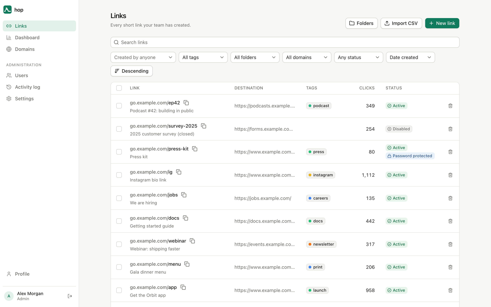

The list shows every link of the team with its destination, tags, clicks and status. Search by ending, destination, title or notes, and filter by owner, tag, folder, domain and status (active, disabled, expired, password protected, broken). Select several links to add or remove a tag, move them to a folder, turn them on or off, or delete them in one go.

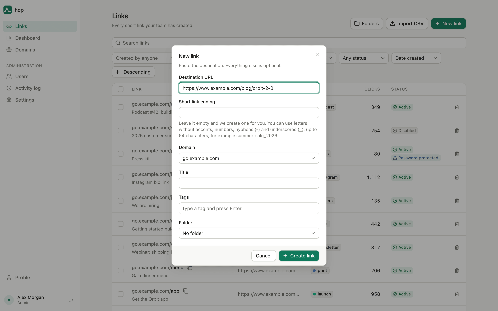

Creating a link takes only the destination. Everything else is optional:

- **Ending**: choose one (`go.example.com/spring-sale`) or let hop generate a short one. Letters, numbers, `-` and `_`, up to 64 characters. Endings are case sensitive, like in YOURLS.
- **Title**: fetched from the destination page while you type, editable.
- **Tags** and **folders**: folders can be nested, tags have colours.
- **Notes**: internal, only your team sees them.

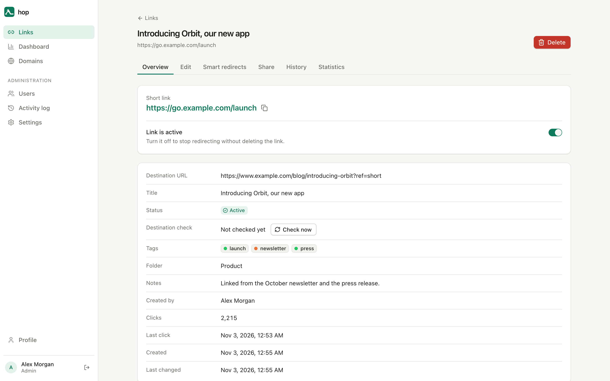

Each link has its own page. Besides what you set when creating it, you can:

- change the **destination** at any time: printed QR codes and links already shared keep working;
- turn the link **off** without deleting it;
- protect it with a **password**, which visitors type on a simple page before being redirected;
- make it **expire** on a date or after a number of clicks, and send later visitors to a **fallback** page;
- pick the **redirect type** (301, 302, 307 or 308);
- **forward the query string**, so `go.example.com/sale?ref=print` reaches the destination with `ref=print`.

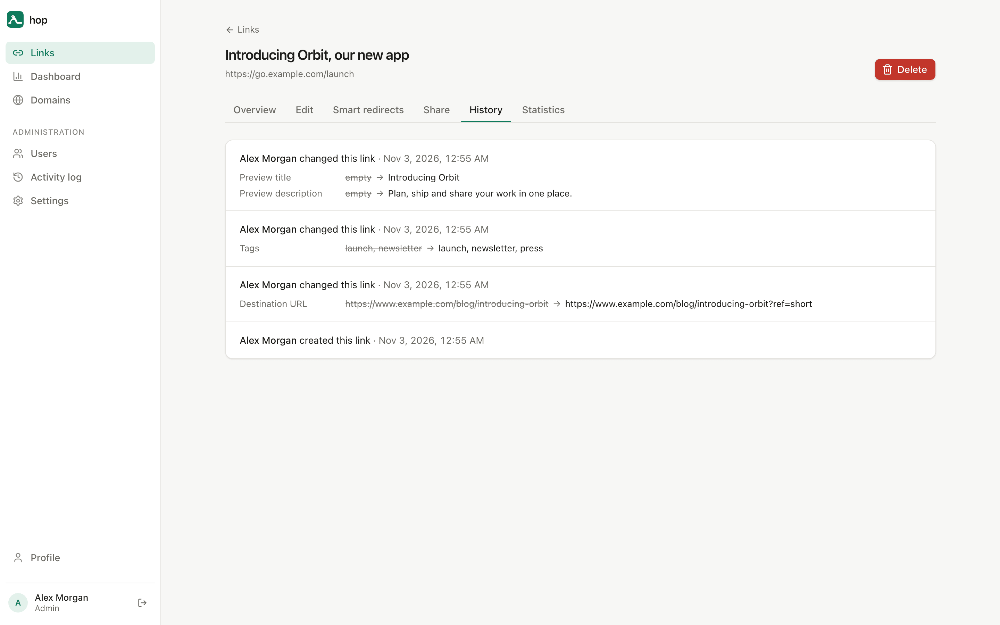

Every change is kept in the link's **history**: who changed what, when, and the value before and after.

Links can also be created in bulk from a **CSV file** (a template is available in the import dialog) and exported to CSV.

## Smart redirects

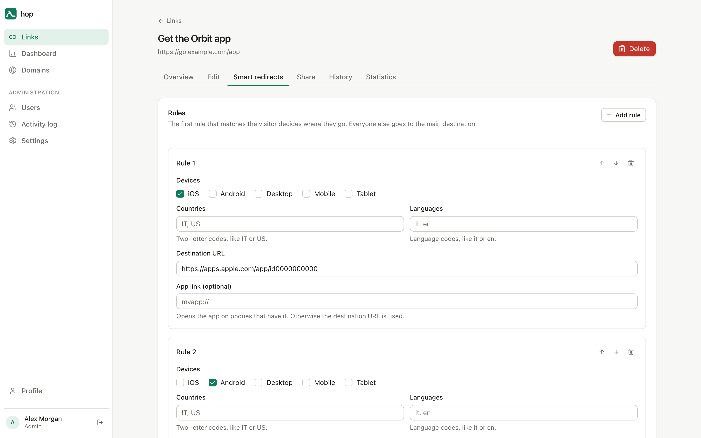

One short link can send each visitor to the right place.

- **Rules** by device (iOS, Android, desktop, mobile, tablet), by country and by language. The first rule that matches decides; everyone else goes to the main destination. A typical use: one link that opens the App Store on iPhones, Google Play on Android phones and the website everywhere else.
- **App links**: a rule, or the link itself, can try to open your app (`myapp://…`) on phones that have it and fall back to the web address.
- **A/B tests**: split visitors between two or more destinations with the weights you choose. Statistics show how each one performs.

## Sharing

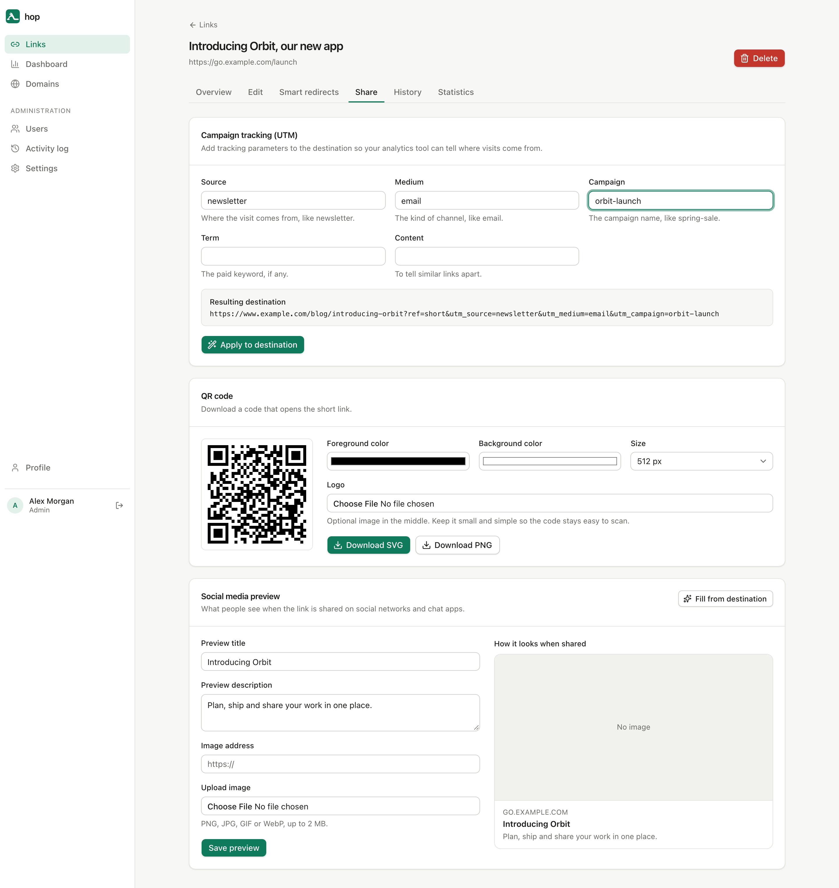

- **UTM builder**: add campaign parameters (source, medium, campaign, term, content) to the destination and see the result before applying it.
- **QR codes**: download as PNG or SVG, pick the colours and size, add a logo in the middle. Anyone can also get a plain one from the short link itself, as in YOURLS: add `.qr` for a PNG (`go.example.com/sale.qr`) or `.qrv` for an SVG. Looking at a QR code is not counted as a visit.
- **Share preview**: set the title, description and image that social networks and chat apps show when someone posts the link. Upload the image or point to one.

## Domains

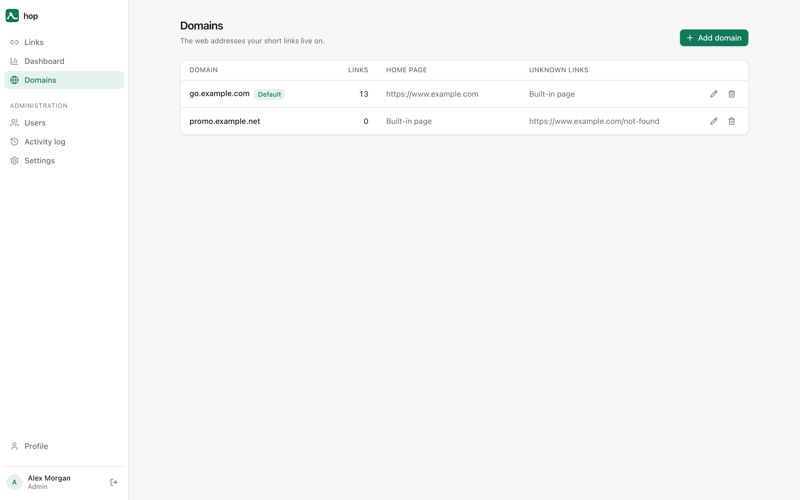

Use as many short domains as you like on the same installation: one for your brand, one for a campaign, one for a client. One of them is the default; each person can pick their own default domain in their profile.

For each domain you choose where visitors go when they open the bare domain (`go.example.com/`) and when they open an ending that does not exist.

## Statistics

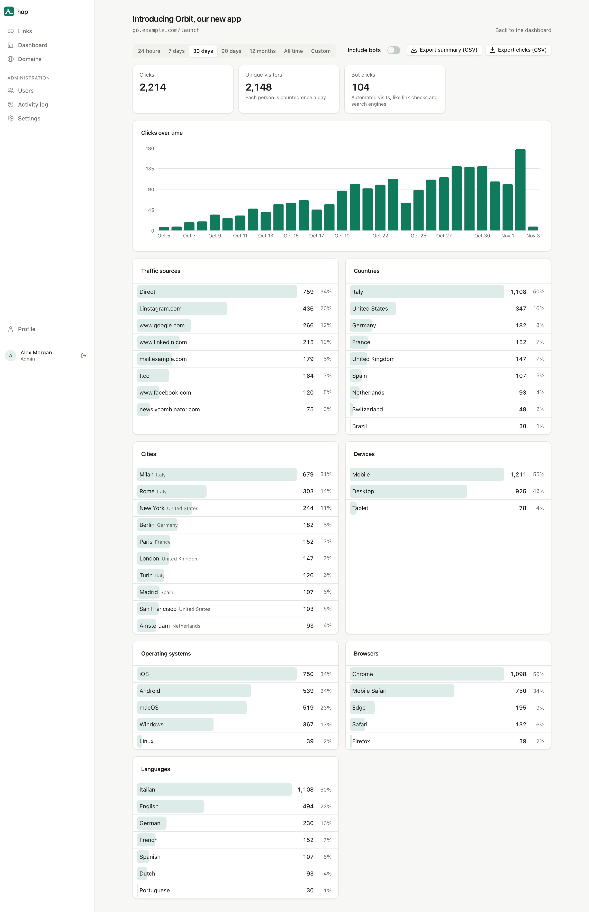

Every click is stored in your database, with:

- clicks over time and **unique visitors**;
- **traffic sources**, **countries**, **cities**, **devices**, **operating systems**, **browsers** and **languages**;
- for links with rules or A/B tests, how many visitors each **destination** received.

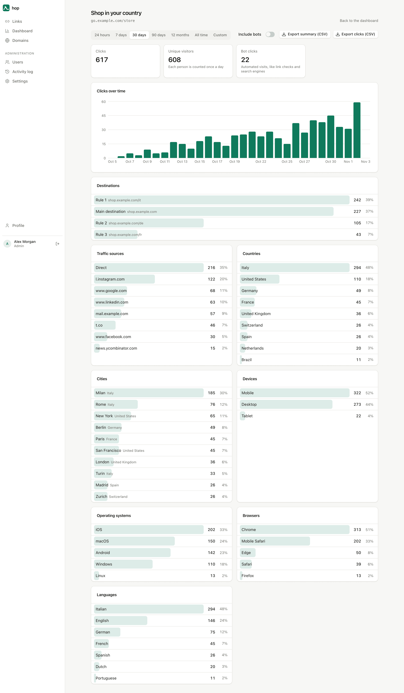

Pick a period (last 24 hours up to all time, or custom dates). **Bots** such as link checkers and search engines are counted apart and left out of the numbers unless you include them. Everything can be exported to **CSV**, as totals or as one row per click.

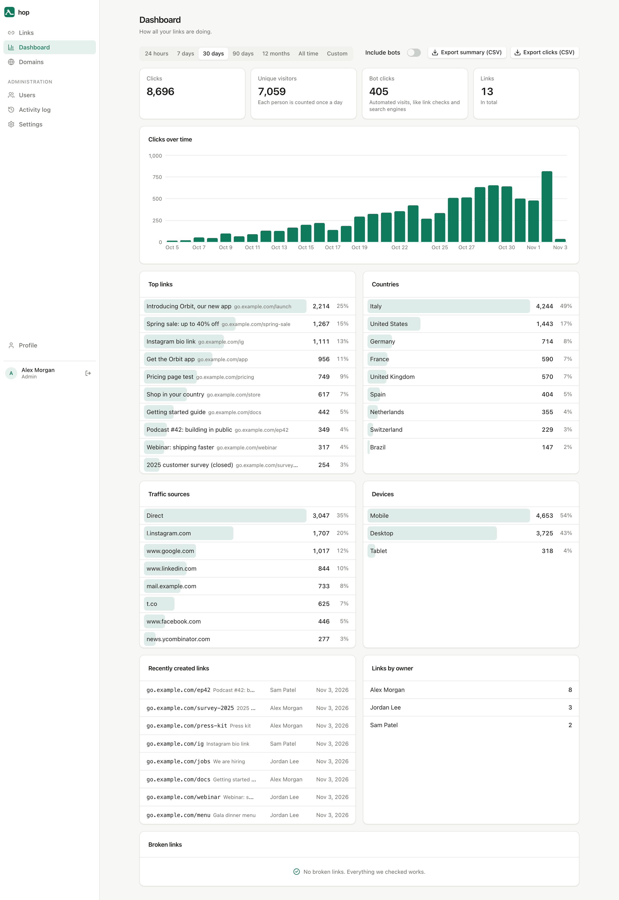

The **dashboard** shows the whole team at once: top links, countries, sources, devices, recently created links, links by owner and broken links.

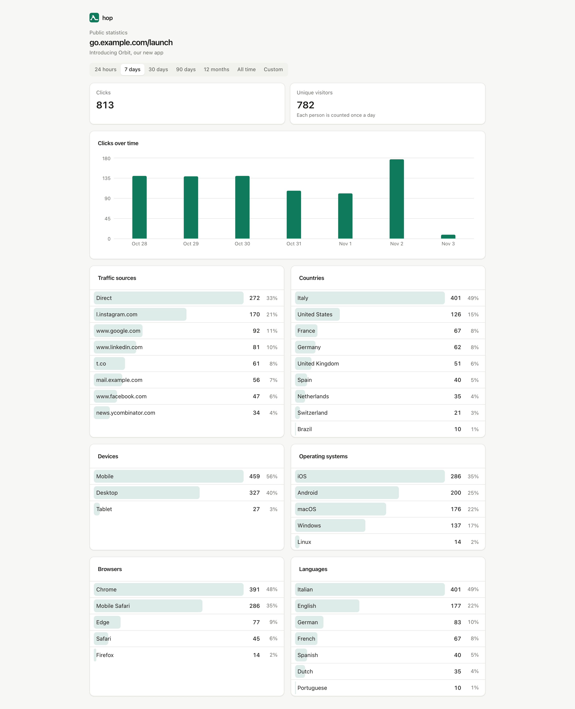

A link can have a **public statistics page**, off by default, to share results with a client or a partner without giving them an account. Turn it on at the top of the link's statistics and copy its address. It shows clicks, countries, devices and sources; notes, the owner and cities stay private.

Add `+` to a short link (`go.example.com/sale+`) to open its statistics, as in YOURLS: the public page when it is on, otherwise the statistics in the app, after signing in.

**Privacy.** hop never stores visitor IP addresses. A unique visitor is recognised by a hash of the address and the browser that changes every day, so nobody can be followed across days. **Retention** is up to you (Settings, Statistics): keep the click history forever or for a set time. Link totals are never deleted.

## Team and sign-in

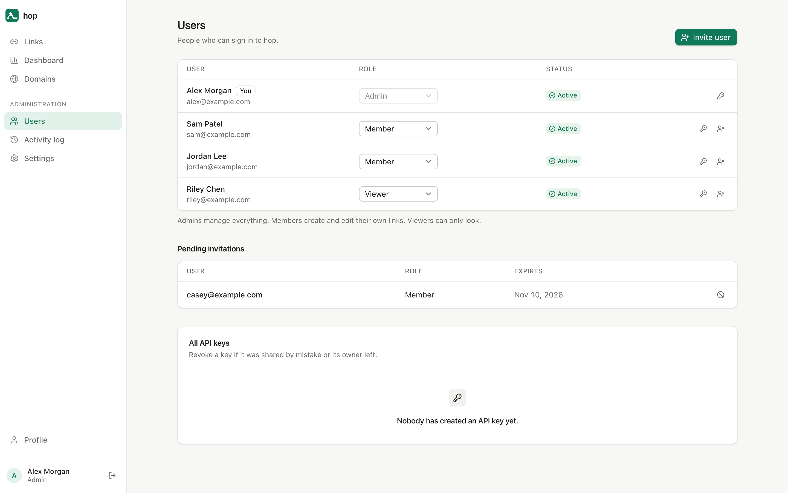

- **Roles**: admins manage everything; members create links and change only their own; viewers can only look. Everyone sees every link.
- **Invitations** by email, or as a link you send yourself when email is not set up.
- **Activity log**: who did what, and when, across the whole installation.

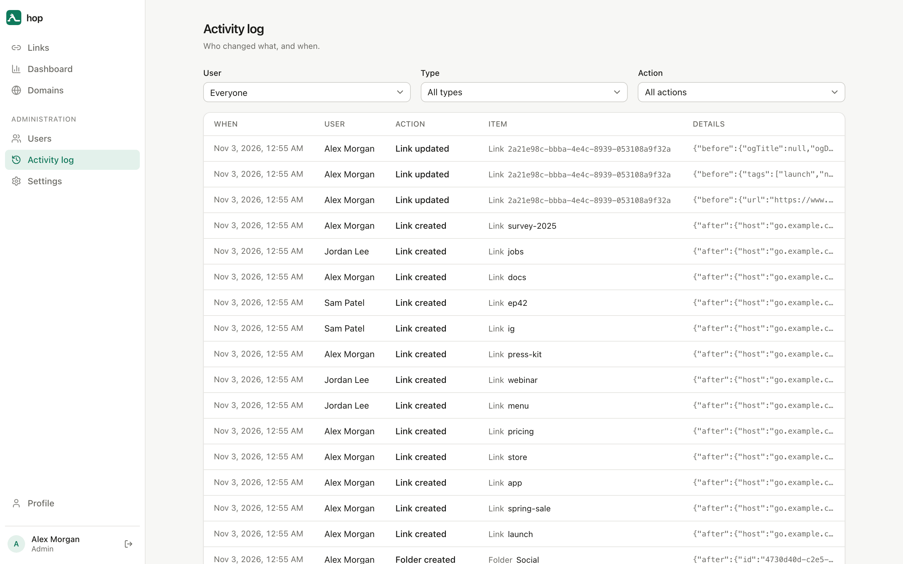

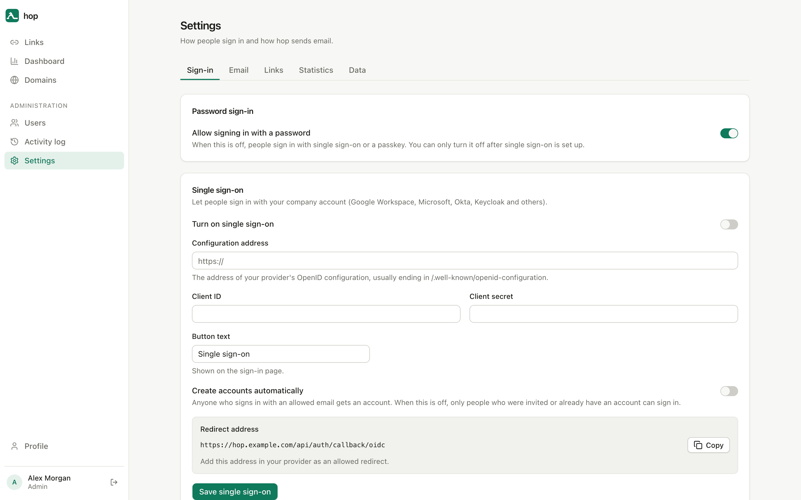

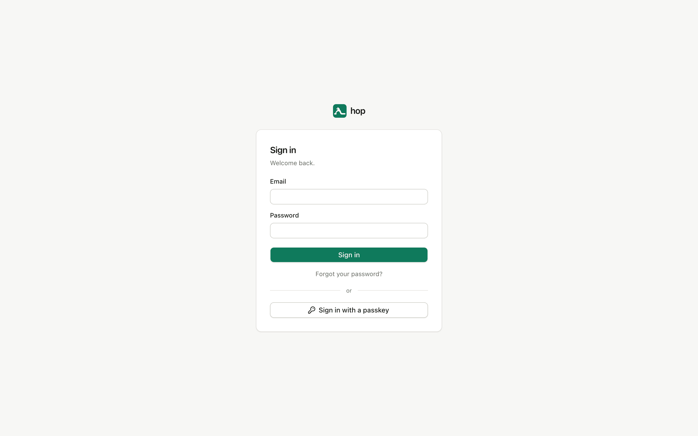

Ways to sign in:

- **email and password**, with password reset by email when email is set up;
- **passkeys** (fingerprint, face or a security key), added from each person's profile;
- **single sign-on** with any OpenID Connect provider: Google Workspace, Microsoft Entra ID, Okta, Keycloak and others. The sign-in button shows the Google or Microsoft logo when it recognises the provider. Accounts can be created automatically, with a chosen role, for allowed email domains, or only for people who were invited.

After signing in you land on the page you asked for, for example a link's statistics opened from a `+` link.

Once single sign-on works, password sign-in can be turned off.

Email (for invitations and password resets) is set up in Settings, with any SMTP server, or through environment variables.

## API and automation

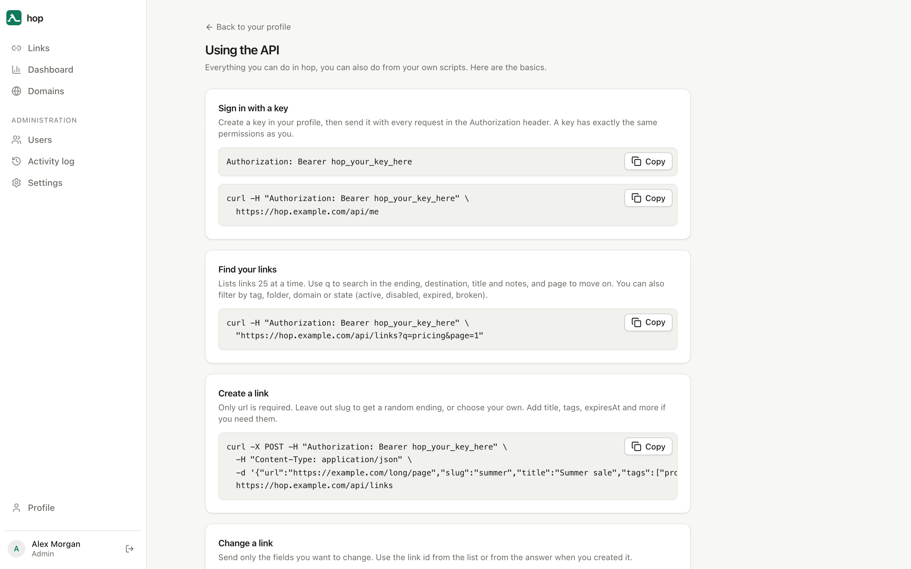

Everything you can do in hop you can also do from your own scripts, with a **personal API key** sent as a bearer token:

```sh
curl https://hop.example.com/api/links \
  -H "Authorization: Bearer hop_…" \
  -H "Content-Type: application/json" \
  -d '{"url": "https://www.example.com/spring", "slug": "spring"}'
```

The **API** page in the app explains how to find, create, change and delete links and read statistics, with examples. Admins can see and revoke everyone's keys.

There is also a **bookmarklet** to shorten the page you are on, and on Android the installed app appears in the **share menu**.

## Data, backups and migration

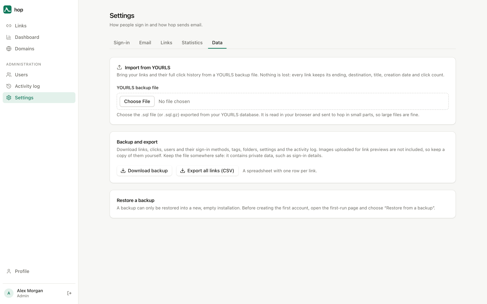

- **Import from YOURLS**: upload the `.sql` dump of your YOURLS database (or `.sql.gz`). Links keep their ending, destination, title, creation date and click count, and the full click history comes along. Importing the same or a newer dump again never duplicates clicks. Step by step guide: [MIGRATION.md](MIGRATION.md).
- **Backup**: one file with links, clicks, users and their sign-in methods, tags, folders, settings and the activity log. Images uploaded for share previews are not included.
- **Restore** a backup into a new installation, for example to move from Docker to Cloudflare or back.
- **Export all links** to CSV.

## Safety

- **Unsafe destinations** are refused when a Google Safe Browsing key is set.
- **Blocked destinations**: a list of domains (with their subdomains) that links may not point to.
- **Broken links**: hop checks destinations periodically and flags the ones that stop answering. You can also check one on demand.
- Requests made by hop itself (page titles, link checks) never reach private or internal network addresses.
- Sign-in attempts and link passwords are **rate limited**; forms are protected against cross-site requests; the app sends strict security headers.
- On a fresh public installation, a **setup token** keeps strangers from creating the first account.

## Operations

- `/healthz` answers when the app and its database work: point your uptime monitor or orchestrator at it.
- `/metrics` exposes Prometheus metrics (links, clicks, users, domains, broken links). It is on only when `METRICS_TOKEN` is set, and asks for that token.
- Periodic jobs (retention, link checks) run every hour: a Cron Trigger on Cloudflare, a timer in the Docker image.
- Database migrations run on deploy (Cloudflare) or at startup (Docker).

See [DEPLOY.md](DEPLOY.md) for every setting.

## Interface

<p>
  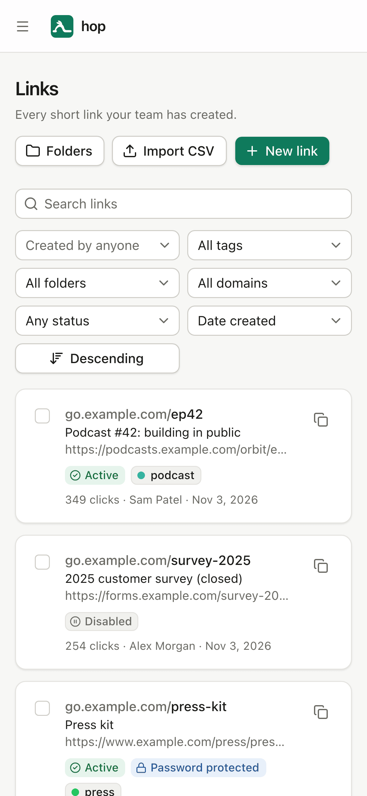
  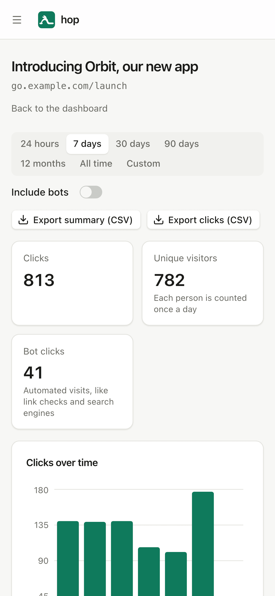
</p>

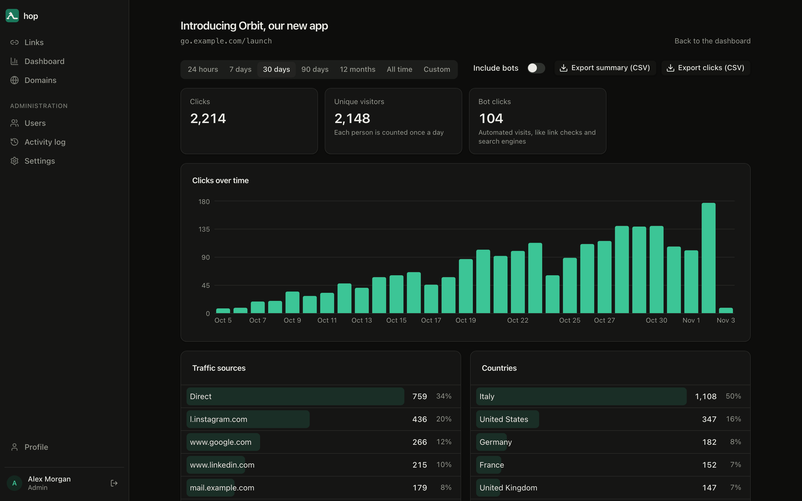

- **English and Italian**, picked from the browser or set in the profile.
- **Light and dark theme**, following the device or chosen by hand.
- Works on **phones**, and can be **installed as an app** on desktop and mobile. A new release shows on the next normal reload, and an open app updates itself when you come back to it.
- Every tab of a link has its own address (`/links/<id>/stats`, `/links/<id>/edit`…), so you can bookmark or share it.
- Usable with the keyboard and screen readers.
