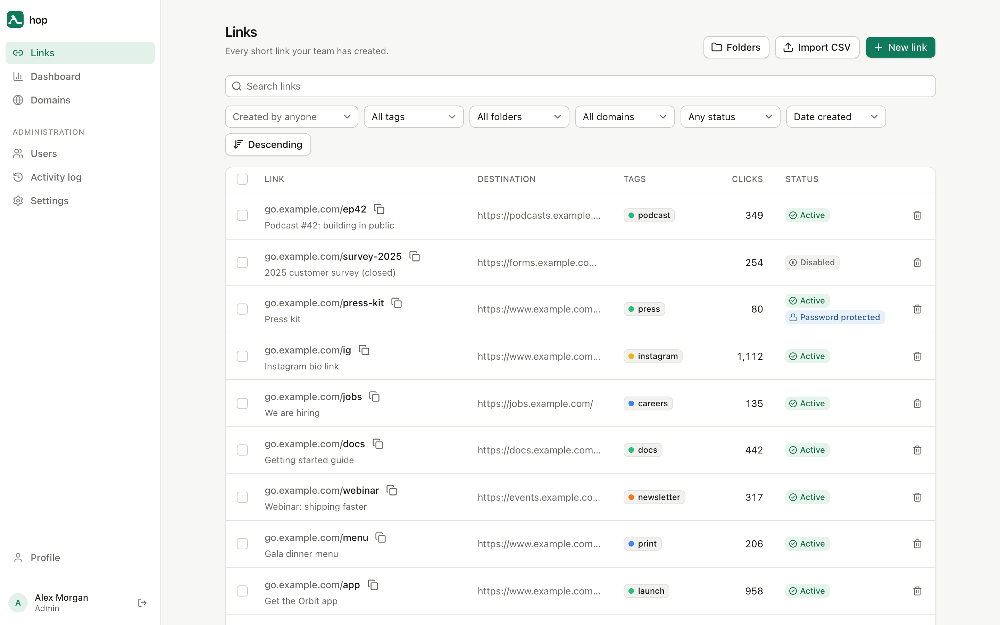
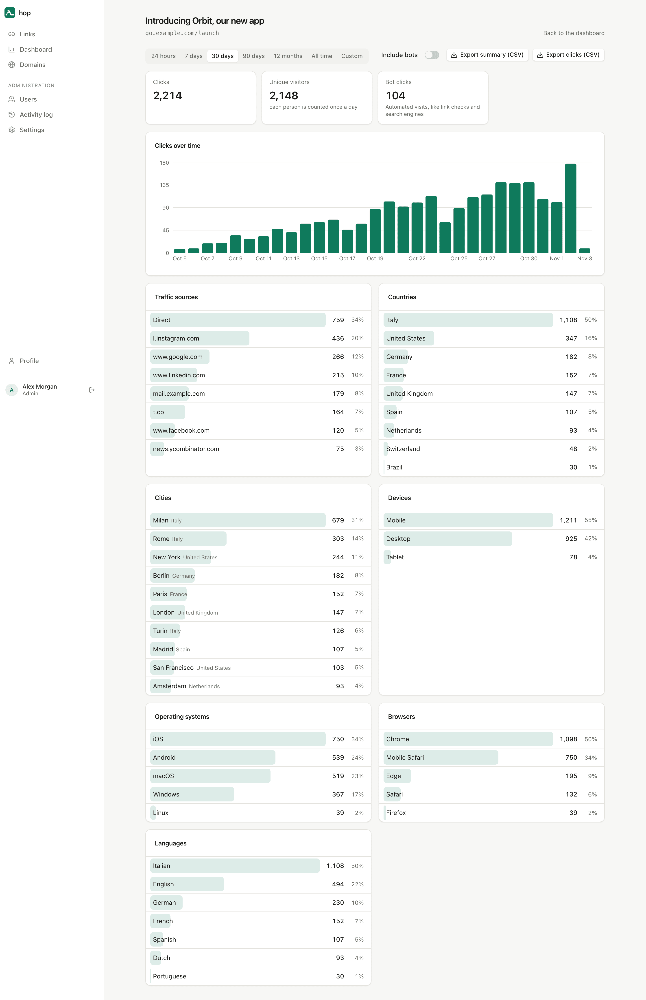
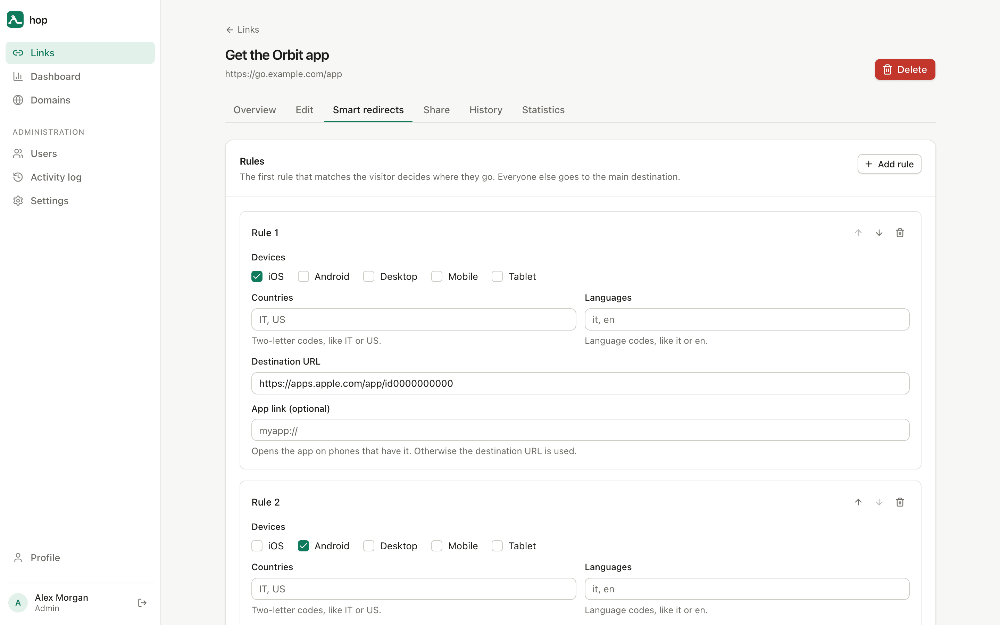
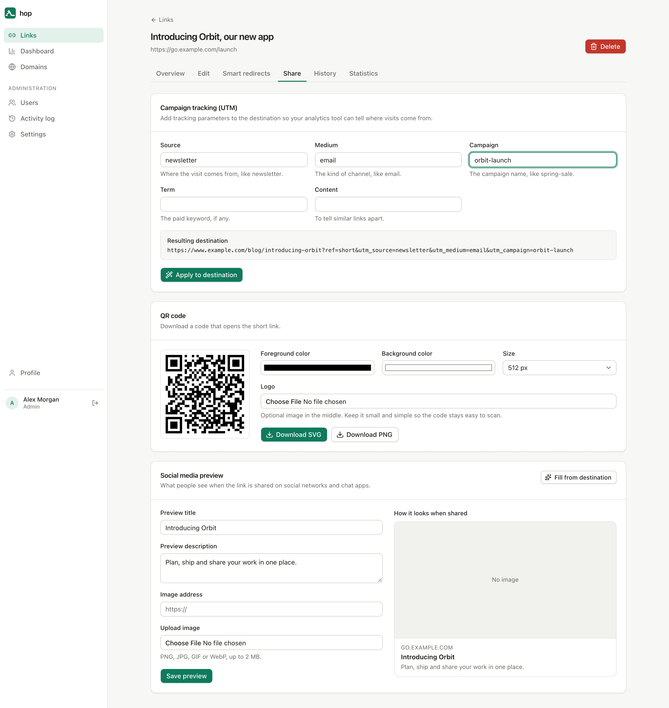
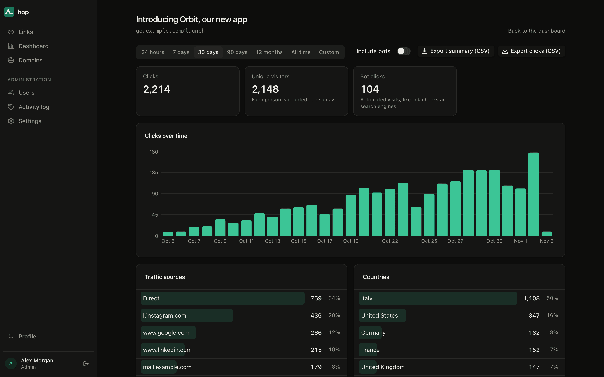

<p align="center">
  
</p>

<h1 align="center">hop</h1>

<p align="center">
  Short links you own: a self-hosted URL shortener with smart redirects and real click statistics.<br>
  Built for <strong>Cloudflare Workers</strong> (D1 + R2). Also runs anywhere with <strong>Docker</strong>.
</p>

<p align="center">
  <a href="https://deploy.workers.cloudflare.com/?url=https://github.com/16bitsrl/hop"></a>
</p>



## Why hop

- **Yours.** Your domains, your database, your data. No per-link pricing, no seats, no tracking pixels.
- **Cheap to run.** On Cloudflare a small team usually stays within the free plan, and redirects run at the edge, close to your visitors.
- **Statistics that keep.** Every click goes into your own database and stays there as long as you want, not 30 or 90 days.
- **Private by design.** Visitor IP addresses are never stored. Unique visitors are counted with a hash that changes every day.
- **For a team.** Several users with roles, single sign-on, passkeys, an activity log and an API.
- **Easy to leave YOURLS.** Import your YOURLS database with its full click history in a few clicks.

## Features

| | |
| --- | --- |
| **Links** | Custom or generated endings, tags, nested folders, notes, editable destination, change history, bulk actions, CSV import and export |
| **Control** | Password protection, expiry by date or number of clicks with a fallback page, on/off switch, 301/302/307/308, query string forwarding |
| **Smart redirects** | By device (iOS, Android, desktop, mobile, tablet), country and language; A/B tests with weights; app deep links |
| **Sharing** | UTM builder, QR codes with colours and a logo, custom preview (title, description, image) for social networks and chats |
| **Domains** | As many short domains as you like, a default one, custom root and "not found" pages for each |
| **Statistics** | Clicks over time, unique visitors, traffic sources, countries, cities, devices, systems, browsers, languages, per rule and per A/B variant; bots kept apart; team dashboard; CSV export; optional public page per link; configurable retention |
| **Team** | Admin, member and viewer roles; invitations; activity log |
| **Sign-in** | Email and password, passkeys, single sign-on (OpenID Connect: Google Workspace, Microsoft, Okta, Keycloak and others), password reset by email; password sign-in can be turned off |
| **Operations** | REST API with personal keys, full backup and restore, broken link checks, blocking of unsafe destinations (Google Safe Browsing), health check, Prometheus metrics |
| **Interface** | English and Italian, light and dark theme, works on phones and installs as an app |

Every feature, with screenshots: **[FEATURES.md](FEATURES.md)**.

<table>
  <tr>
    <td></td>
    <td></td>
  </tr>
  <tr>
    <td></td>
    <td></td>
  </tr>
</table>

## Deploy

hop is the same code in two shapes. Pick the one that suits you.

| | Cloudflare Workers | Docker |
| --- | --- | --- |
| Database | D1 | SQLite file on a volume |
| Uploaded images | R2 | the same volume |
| Visitor location | Cloudflare, built in | Cloudflare headers behind a Cloudflare proxy, or a free GeoIP file |
| Periodic jobs | Cron Trigger | built-in timer |
| Good for | the least maintenance, global edge | your own server, Coolify, Openship, any Docker host |

Two kinds of hosts point at the same deployment: the **app host** (for example `hop.example.com`) serves the admin app and the API; every other host is a **short domain** (for example `go.example.com`) and only redirects.

### Cloudflare, with one click

Press the button. Cloudflare copies this repository into your GitHub account, creates the D1 database and the R2 bucket, and asks for a few values:

| Value | What to put |
| --- | --- |
| `APP_HOST` | The host of the admin app, without `https://`: a domain of yours (`hop.example.com`) or the Worker's `workers.dev` address (`hop.<your-subdomain>.workers.dev`) |
| `APP_URL` | The same with `https://` in front |
| `AUTH_SECRET` | At least 32 random characters: `openssl rand -base64 32` |
| `SETUP_TOKEN` | Any secret you choose. You will be asked for it when you create the first account, so nobody else can claim the installation |

[](https://deploy.workers.cloudflare.com/?url=https://github.com/16bitsrl/hop)

Then open the app host, create the first account (it becomes the admin) and add your short domains: in the Cloudflare dashboard as Custom Domains of the Worker, and in hop under **Domains**. Every push to your copy of the repository deploys again, and database migrations run on each deploy.

### Cloudflare, by hand

```sh
pnpm install
pnpm exec wrangler d1 create hop          # put the printed database_id in wrangler.jsonc
pnpm exec wrangler r2 bucket create hop-blobs
pnpm exec wrangler secret put APP_HOST    # hop.example.com
pnpm exec wrangler secret put APP_URL     # https://hop.example.com
pnpm exec wrangler secret put AUTH_SECRET
pnpm exec wrangler secret put SETUP_TOKEN
pnpm build && pnpm run deploy             # applies migrations, then deploys
```

### Docker (Coolify, Openship, any host)

```sh
docker build -t hop .
docker run -d --name hop -p 3000:3000 -v hop-data:/data \
  -e APP_HOST=hop.example.com \
  -e AUTH_SECRET="$(openssl rand -base64 32)" \
  -e SETUP_TOKEN=choose-a-secret \
  hop
```

Or use the included [`docker-compose.yml`](docker-compose.yml): on Coolify create a "Docker Compose" resource from this repository, set `APP_HOST` and `AUTH_SECRET`, and list the app host and every short domain in the service's domains. Everything that must survive restarts lives in `/data`, and migrations run at startup.

The full guide, with every setting, GeoIP, backups and updates, is in **[DEPLOY.md](DEPLOY.md)**. Coming from YOURLS? See **[MIGRATION.md](MIGRATION.md)**.

## Development

Requirements: Node 22 or newer and pnpm.

```sh
pnpm install
echo "AUTH_SECRET=$(openssl rand -base64 32)" > .dev.vars   # the dev server sets the hosts itself
pnpm db:migrate:local
pnpm dev                         # http://app.localhost:5173
```

Any other `*.localhost:5173` host acts as a short domain, so you can try redirects locally (add `go.localhost:5173` under Domains).

| Command | What it does |
| --- | --- |
| `pnpm test` | Unit tests (Vitest) |
| `pnpm e2e` | End-to-end tests (Playwright) on the Workers runtime, with a separate local test database |
| `pnpm e2e:node` | The same suite on the Node + SQLite build |
| `pnpm typecheck` | TypeScript |
| `pnpm build:node && node scripts/screenshots.mjs` | Regenerates the screenshots in this README, on throwaway data |

Stack: [Hono](https://hono.dev) on the server, [Drizzle](https://orm.drizzle.team) over D1 or SQLite, [Better Auth](https://www.better-auth.com) for accounts, React with [TanStack Router](https://tanstack.com/router) and [shadcn/ui](https://ui.shadcn.com) for the app.

## License

[O'Saasy License](LICENSE.md): use it, change it and run it for yourself, your company or your clients. The one thing you may not do is offer hop itself to others as a hosted service that competes with us.

Made by [16bit](https://16bit.it).
